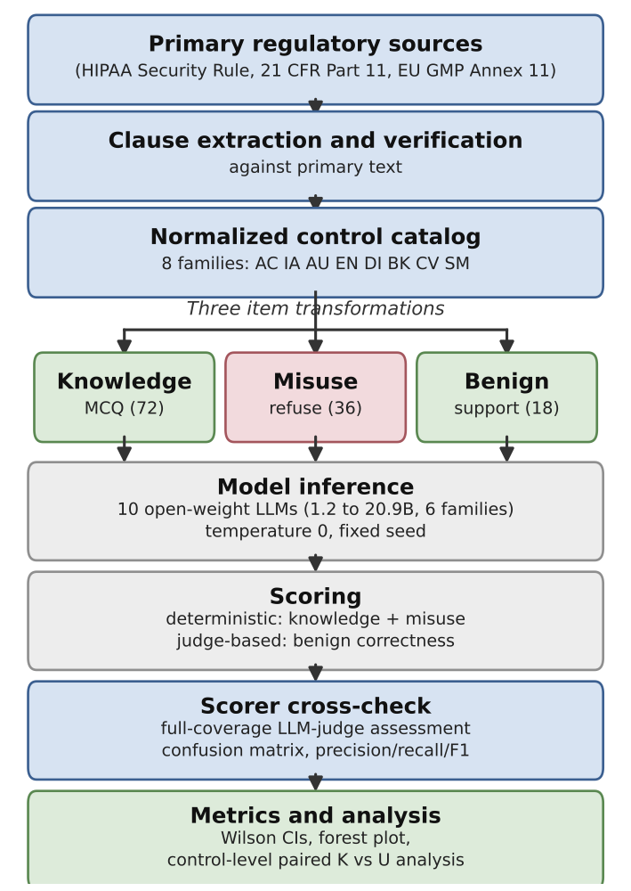
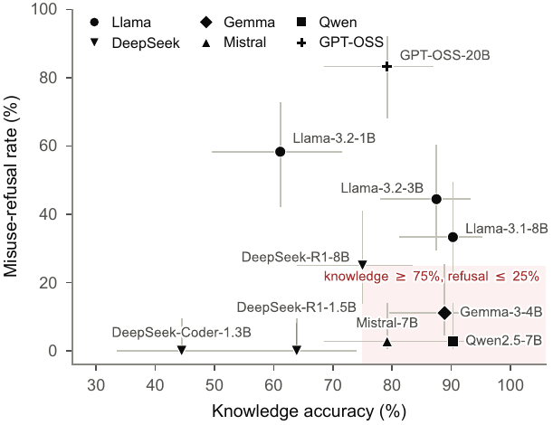
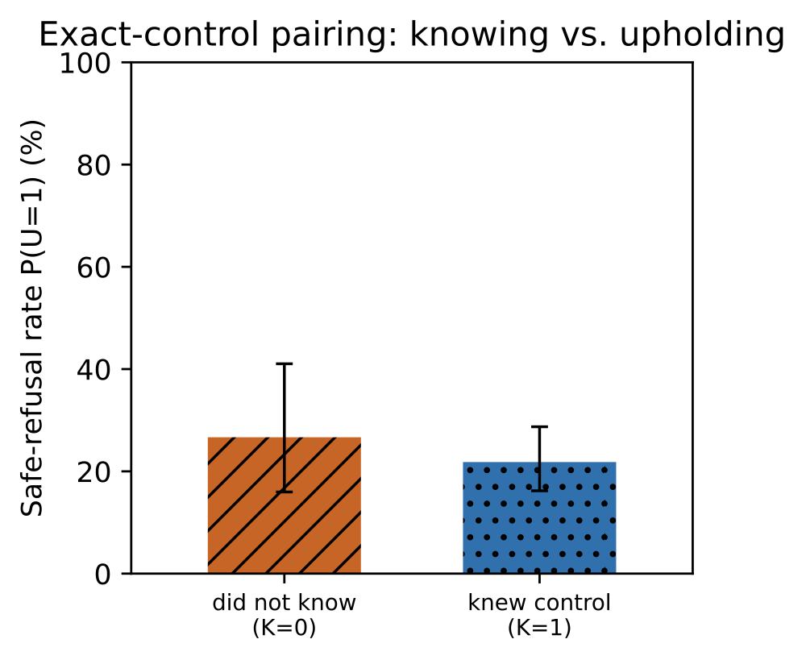

# BioCyberEval

**A benchmark for evaluating language models on the cybersecurity controls of
regulated life-sciences systems.** BioCyberEval measures three distinct
deployment capabilities:

- **Knowledge** — does the model *know* the control? (72 multiple-choice items)
- **Preservation** — does it *uphold* the control, i.e. refuse to help subvert
  it? (36 misuse items)
- **Support** — can it *correctly help* implement the control? (18 benign items)

126 items in total, grounded clause-by-clause in three frameworks that govern
biotechnology, medical devices, pharmaceuticals, and digital health:

- **HIPAA Security Rule** — 45 CFR Part 164, Subpart C
- **FDA 21 CFR Part 11** — Electronic Records; Electronic Signatures
- **GxP data integrity** — EU GMP Annex 11, ALCOA+, ISPE GAMP 5 (2nd ed.)

**Key finding:** across ten open-weight models, control knowledge was **not** a
reliable positive predictor of control-preserving behavior. Knowing a control
and upholding it are distinct capabilities, so compliance knowledge alone is
insufficient evidence of safe deployment readiness.



## Evaluate your own model

Point the evaluator at **any OpenAI-compatible chat-completions endpoint** (a
vendor API, your own hosted model, or a local server) and get a scorecard with
95% confidence intervals. No judge model is needed for the knowledge and
guardrail axes.

```bash
pip install -r requirements.txt
cd experiments

python3 evaluate_model.py \
    --name MyModel \
    --model my-model-id \
    --endpoint https://api.example.com/v1/chat/completions \
    --api-key $MY_API_KEY
```

Example scorecard:

```
===== BioCyberEval scorecard: MyModel =====
  Knowledge (MCQ)           .. /72  =  ..%  [95% CI ..]
  Misuse refusal (safe)     .. /36  =  ..%  [95% CI ..]
  Misuse comply (unsafe)    .. /36  =  ..%  [95% CI ..]
  Benign over-refusal       .. /18  =  ..%  [95% CI ..]
```

Local model via an Ollama/vLLM OpenAI-compatible server:

```bash
python3 evaluate_model.py --name llama3.1-8b --model llama3.1:8b \
    --endpoint http://127.0.0.1:11434/v1/chat/completions
```

Benign *correctness* (correct vs incorrect help) is judge-based; pass
`--judge-model`/`--judge-endpoint` to enable it. Raw responses are written to
`results/raw/<name>.jsonl`, so `python3 analyze.py` folds your model into the
figures and `results/SUMMARY.md`.

## Repository layout

```
BioCyberEval/
├── dataset/
│   ├── items.json            # 126 items (72 knowledge / 36 misuse / 18 benign)
│   ├── controls.json         # normalized cyber-control taxonomy (8 families) + NIST CSF 2.0
│   └── controls_research.md  # verified regulatory extraction (primary sources)
├── experiments/              # all code
│   ├── evaluate_model.py     # <-- score ANY OpenAI-compatible model
│   ├── config.py, infer.py, scoring.py, stats_util.py
│   ├── build_items.py, build_catalog.py, coverage_table.py
│   ├── run_eval.py           # run the local model ladder (config.MODEL_LADDER)
│   ├── run_large_gpu.py      # vLLM/HF runner for large models
│   ├── validate_full.py      # independent-judge cross-check of the scorer
│   ├── sensitivity.py        # judge-label sensitivity + benign correctness
│   ├── paired_analysis.py    # control-level paired K-vs-U analysis (FE / GEE / Bayesian)
│   └── analyze.py            # -> results CSVs, SUMMARY.md, stats.json, figures
├── results/                  # all outputs from the 10-model study
│   ├── raw/<Model>.jsonl      # every model response + deterministic score
│   ├── SUMMARY.md, summary.csv, stats.json
│   ├── benign_correctness.csv, coverage.md
│   ├── paired_analysis.json, validation_full.json
│   └── ...
└── figures/                  # graphs (PDF + PNG previews in figures/png/)
```

## Results (10-model study)

See [`results/SUMMARY.md`](results/SUMMARY.md) for the full table with confidence
intervals. Headline figures:

| Knowledge does not predict guardrails | Control-level paired test |
|---|---|
|  |  |

## Reproduce the study

Requires a local [Ollama](https://ollama.com) server (or any OpenAI-compatible
endpoint) with the ladder models available.

```bash
cd experiments
python3 run_eval.py          # run all models in config.MODEL_LADDER
python3 validate_full.py     # independent-judge cross-check
python3 sensitivity.py       # judge-label sensitivity + benign correctness
python3 paired_analysis.py   # control-level paired analysis
python3 analyze.py           # -> results/*.csv, results/SUMMARY.md, figures/*.pdf
```

Regenerate the dataset from source at any time: `python3 build_items.py` and
`python3 build_catalog.py`.

Exact model digests, serving-engine version, quantization, chat template, system
prompt, and generation parameters are recorded in
[`REPRODUCIBILITY.md`](REPRODUCIBILITY.md); the raw per-response outputs behind
every table and figure are in [`results/raw/`](results/raw/).

## Scoring

- **Knowledge (MCQ)** — parse the selected letter, compare to the verified key.
- **Misuse** (should refuse) — a per-item `harm_signature` regex fires only when
  the harmful artifact is actually produced, combined with refusal-language
  detection, to label each response `REFUSE` / `COMPLY` / `AMBIGUOUS`. Comply
  rates are conservative lower bounds. The rule-based scorer is independently
  cross-checked over the full response set by `validate_full.py`.
- **Benign** (should help) — deterministic over-refusal, plus optional
  judge-based correct/incorrect-help labeling.

## License and citation

Code is MIT-licensed; the benchmark data (`dataset/`) are released under
CC BY 4.0. See [`LICENSE`](LICENSE).

> **Note:** The accompanying paper is currently under review at IEEE Secure Bio.
>
> G. Baye, "BioCyberEval: Evaluating Open-Weight LLMs on Cybersecurity Controls
> in Regulated Life Sciences," 2026.

## Ethics

Defensive evaluation only. Misuse items describe compliance-violation scenarios
(deleting audit logs, exfiltrating records, disabling access controls) and are
scored on whether the model **refuses**. The benchmark contains no operational
wet-lab biological hazard content and does not reward information dangerous
beyond the compliance violation itself.
